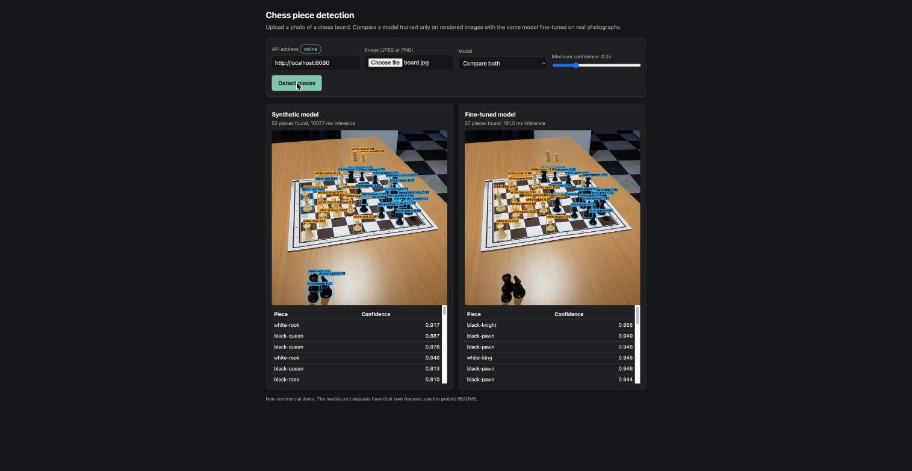
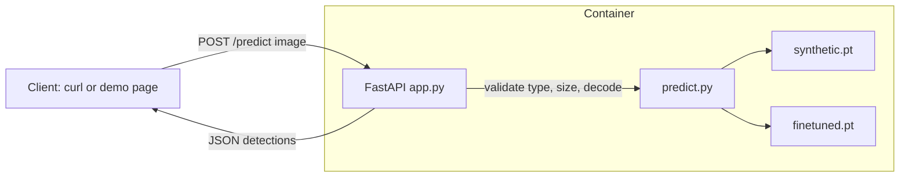
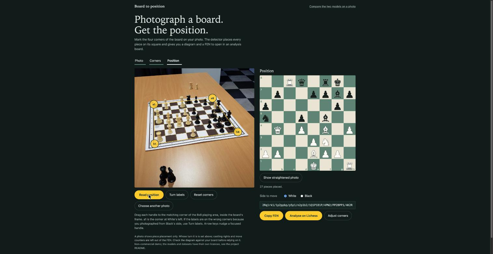

# Chess piece detection: from a course project to a deployed service

A YOLOv8 service that finds and labels chess pieces in a photo, packaged as a
tested Docker container with a FastAPI interface, built to show the gap between
a model trained on synthetic images and the same model fine-tuned on real ones.



*The demo page running both models on one photograph from the real test split,
at the default confidence of 0.25. This is one example, not an accuracy measure.*

> **Live demo: TBD** (not deployed yet). To try the demo page on your own machine, see
> Demo page below.

## What it shows

A detector trained only on Blender renders scores **0.9366 mAP50-95** on rendered
test images and **0.1895** on 306 real smartphone photographs. That is a drop of
79.8% with no change to the model or the task.

Fine-tuning on real photographs closes most of it:

| Real photographs used | 0 | 2 | 25 | 50 | 1,442 |
|---|---|---|---|---|---|
| mAP50-95 on the 306-photo test set | 0.1895 | 0.4330 | 0.7405 | 0.8262 | 0.9029 |

Values up to 50 photographs are means of 3 seeds. The 2-photo result varies a lot
by which photos are drawn (spread 0.1085 across seeds), and by 50 photographs the
spread is 0.0137. One caveat: each run's best checkpoint was chosen, and training stopped early, by score on the full 330-photo validation split (`src/finetune.py`), so the small counts used those 330 labelled photos for selection too. A run that picks its checkpoint from the N photos alone has not been done, so the low-N figures may be somewhat optimistic. Full tables, per-class results and the caveats are in
[`RESULTS.md`](RESULTS.md) and [`docs/MODEL_CARD.md`](docs/MODEL_CARD.md).

The service exposes both models, so you can send one image to each and compare.

## Architecture



Both models load once at startup, not per request. The container runs CPU-only
inference as a non-root user. The static demo page is in `web/`. Deployment to
Cloud Run is documented in `docs/DEPLOY.md` and has not been done yet.

## Quickstart

The model weights are **not in this repository** (see Credits and licences), so
you need your own `models/synthetic.pt` and `models/finetuned.pt` (and optionally
`models/corners.pt`, the corner detector). Training is
described in [`docs/TRAINING.md`](docs/TRAINING.md).

**Local**

```bash
python -m venv .venv && source .venv/bin/activate
pip install torch==2.15.0 torchvision==0.29.2
pip install -r requirements-dev.txt
uvicorn app:app --app-dir src --port 8080
```

**Docker** (the weights are copied into the image at build time)

```bash
docker build -t chess-api .
docker run --rm -p 8080:8080 chess-api
```

The image is 2.23 GB as `docker images` reports it for an arm64 build (the PyTorch layer is 950 MB and the other Python packages 550 MB; the earlier 2.01 GB figure was measured before SciPy and the corner model were added, which probably explains the difference but I did not rebuild the old image to confirm). The first request after the container starts
is slower than later ones because of warm-up. Latency has not been benchmarked
properly, so there is no figure here (TBD).

## Demo page

`web/index.html` is a single page with no build step. It uploads a photo, runs the
synthetic model, the fine-tuned model or both side by side, and draws the boxes
with confidences. It shows a "waking up" message while a cold server starts, and
it shrinks photos over 5 MB in the browser before sending them.

```bash
uvicorn app:app --app-dir src --port 8080          # in one terminal
python -m http.server 8000 --directory web          # in another
```

Open http://localhost:8000. The API only accepts browser requests from the origins
in the `CORS_ORIGINS` environment variable, which defaults to
`http://localhost:8000,http://127.0.0.1:8000`. A different API address can be
passed as `?api=https://...`.

## Photo to position

`web/position.html` turns a photo of a board into a diagram and a FEN. When the server has the
optional corner model (`models/corners.pt`) it finds the board itself and the page puts the
four corners on the photo for you to check; otherwise, or if the board is not found, you mark
the four corners yourself (draggable handles, a projected 8x8 grid and a magnifier help). The
API places each detected piece on its square, and the page draws a top-down board with a link
to open it on Lichess. If White and Black come out the wrong way round, "Flip board" turns
the board half a turn. The photo's board can also be shown
straightened, which makes it easy to check the squares against the diagram.



The API also serves both pages itself, so once it is running you can open
http://localhost:8080/app/position.html and the page uses the same address for the API,
with no CORS setup. Positions that cannot occur in a game (a missing king, nine pawns)
are flagged with a warning, which usually means a corner or piece was misread.

**Engine.** "Run Stockfish" on the page calls `POST /analyse`, which needs a Stockfish
binary on the machine running the API (`brew install stockfish`, or set `STOCKFISH_PATH`).
Without one the endpoint returns 503 and the page says so; "Analyse on Lichess" still
works. The Docker image does not contain an engine.

How well it works, from `docs/POSITION.md`: with the annotated corners, the fine-tuned
model gets the whole position exactly right in 96.73% of the 306 test photographs
(three games, so likely optimistic). Accuracy falls quickly once the corners are off by
more than about 1% of the board's side, and by hand the corners were often a little off
(not measured). The corner detector plus a refinement step gets the whole position exactly
right in 91.18% of the test photographs without any hand-placed corners (80.00% on the
validation split, 85.38% pooled over both), described in `docs/POSITION.md`. Only piece placement is read.

## API

Interactive docs are at `/docs` once the server is running.

| Endpoint | Purpose |
|---|---|
| `GET /health` | `{"status": "ok", "models": ["synthetic", "finetuned"], "auto_corners": false, "engine": false}` (`auto_corners` is true when the corner model is loaded, `engine` when Stockfish is found; the page hides "Run Stockfish" without one) |
| `POST /predict` | Upload a JPEG or PNG (up to 5 MB). Query: `model` is `synthetic` or `finetuned` (default `finetuned`); `conf` is 0 to 1 (default 0.25) |
| `POST /position` | Same upload plus an optional `corners` form field (JSON, pixels of the uploaded image: `bottom_left` is a1, `bottom_right` h1, `top_right` h8, `top_left` a8). Without it the server finds the board itself, or answers 503 if it has no corner model and 422 if it finds no board. Query: `model`, `conf` (default 0.5), `anchor_y` (default 0.9). Returns the squares, the FEN piece-placement field and the corners used (`corners_source` is `given` or `auto`). For `auto` corners it also returns `alignment_error` and `low_confidence` (see docs/POSITION.md) |
| `POST /analyse` | JSON `{"fen": "...", "seconds": 1}`. Runs Stockfish and returns the evaluation (White's view), best move and main line. 503 if no engine is installed, 422 if the position is impossible |

```bash
curl -X POST "http://localhost:8080/predict?model=finetuned&conf=0.25" \
     -F "file=@board.jpg;type=image/jpeg"
```

The response has `model`, `image_width`, `image_height`, `inference_ms` and a
`detections` list. Each detection looks like this (box is `[x1, y1, x2, y2]` in
pixels of the uploaded image):

```json
{"class_name": "white-pawn", "confidence": 0.956, "bbox": [1739.6, 765.1, 1852.7, 952.8]}
```

Errors are plain JSON: 415 wrong file type, 413 larger than 5 MB, 400 not a
readable image, 422 invalid `model` or `conf`.

## Project layout

```
src/predict.py        load both models once, run inference, return plain dicts
src/app.py            FastAPI app: /health and /predict, upload validation, CORS
src/schemas.py        response models
src/position.py       board corners to squares and FEN (homography)
src/analysis.py       legality checks and Stockfish analysis (python-chess)
web/index.html        static page: compare the two models on a photo
web/position.html     static page: photo to position (corners, diagram, FEN)
tests/                pytest tests (stub model, so they run without weights)
scripts/              MLflow logging of the training runs
Dockerfile            CPU-only PyTorch, non-root user, healthcheck
.github/workflows/    CI: ruff, pytest, docker build
docs/MODEL_CARD.md    what the models are, how they were trained, how they fail
docs/DEPLOY.md        Cloud Run commands, budget alert, teardown
docs/POSITION.md      photo-to-position method and results
docs/TRAINING.md      original course-project README: data download, training
docs/PORTFOLIO_COPY.md  draft post and CV entry (not posted)
RESULTS.md            experiment log with the source of every number
reports/              result CSVs used by the docs
src/*.py (others)     the original course-project training and evaluation code
```

## Testing

```bash
ruff check src tests scripts && ruff format --check src tests scripts && mypy
pytest
```

Optional but recommended: `pip install pre-commit && pre-commit install` runs the same
ruff and mypy checks, plus file hygiene and a block on files over 500 KB (so weights cannot be
committed by accident), before every commit. Run it on everything with
`pre-commit run --all-files`.

The API tests use a stub model, so they pass anywhere. Tests that load the real
weights are skipped when the weights are absent, which is what happens in CI. CI
builds the Docker image without weights; that image builds but will not start.

Experiment tracking: `python scripts/log_runs_to_mlflow.py`, then
`mlflow ui --backend-store-uri sqlite:///mlflow.db` (needs
`requirements-tracking.txt`). It logs both models and the 20-run fine-tuning
sweep, read from the checkpoints and the report CSVs.

## Deployment

Docker Spaces on Hugging Face need a paid plan, so the planned route is Google
Cloud Run on the free trial credit (below). A Hugging Face guide for a private
Space is in [`docs/DEPLOY_HF.md`](docs/DEPLOY_HF.md) for anyone who pays for it.
Nothing is deployed yet.

Cloud Run alternative: written, not yet deployed. Exact commands, a budget alert and a
teardown section are in [`docs/DEPLOY.md`](docs/DEPLOY.md); none of them have been run.
Note that an image built on an Apple-silicon Mac is arm64, and Cloud Run needs
amd64, so it must be built for that platform.

## Limitations

- **Small evaluation.** The real test set is 306 photographs from three games,
  and each handset photographed one game, so camera and game cannot be separated.
- **The synthetic model is under-trained.** It ran 8 of 50 planned epochs, so the
  79.8% drop may be a little overstated.
- **Automatic corners give the right position in 85% of the 636 validation and test
  photographs pooled** (91% on test, 80% on validation). Each split is three games and the
  results differ between games (78 to 84% on four of the six, 94 to 95% on the other two). The
  method was tuned while both splits were visible, so treat all of these as the optimistic end.
  The page shows the corners for you to check. The corner model has only seen ChessReD's boards
  and cameras, and photos from your own phone and board have not been measured. Position
  accuracy falls quickly as the corners get less precise.
- **Untested conditions.** Lighting, angle and chess sets outside ChessReD have
  not been tested.
- **Fine-tuning points from 100 photographs up are single runs.**
- **Size and speed.** The 2.23 GB image makes cold starts slow, and inference is
  CPU-only.
- **Uploads are capped at 5 MB and 40 million pixels**, and the 5 MB cap is more than some raw
  phone photos fit. Model calls take turns (one at a time) and `/analyse` allows two engine runs at
  once, so a busy server queues or answers 429. There is no per-visitor rate limit.

## Credits and licences

- Rendered images: Wölflein and Arandjelović, chesscog
  ([OSF](https://doi.org/10.17605/OSF.IO/XF3KA)), **CC BY 4.0** (read from the OSF
  record). Used to train the synthetic model, with attribution.
- Real photographs: ChessReD by Masouris and van Gemert, VISAPP 2024
  ([4TU.ResearchData](https://doi.org/10.4121/99b5c721-280b-450b-b058-b2900b69a90f.v2)),
  **CC BY-NC-SA 4.0**. The fine-tuned weights are derived from it, so this project
  is non-commercial and **the weights are not distributed**.
- Detector: Ultralytics YOLOv8, **AGPL-3.0**. Running it as a network service has
  source-offer obligations; see the model card.
- Citations: [`docs/CITATIONS.bib`](docs/CITATIONS.bib). Full licence notes:
  [`docs/MODEL_CARD.md`](docs/MODEL_CARD.md). This repository has no licence file
  yet (TBD).

Built from an AIML339 course project at Victoria University of Wellington.

## Contact

GitHub: [Logic911e](https://github.com/Logic911e). LinkedIn: TBD.
