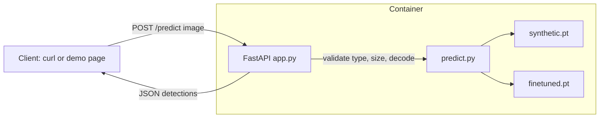

# Chess piece detection: from a course project to a deployed service

A YOLOv8 service that finds and labels chess pieces in a photo, packaged as a
tested Docker container with a FastAPI interface, built to show the gap between
a model trained on synthetic images and the same model fine-tuned on real ones.

> **Screenshot or GIF of the demo: TBD** (the demo page is not built yet)
>
> **Live demo: TBD** (not deployed yet)

## What it shows

A detector trained only on Blender renders scores **0.9366 mAP50-95** on rendered
test images and **0.1895** on 306 real smartphone photographs. That is a drop of
79.8% with no change to the model or the task.

Fine-tuning on real photographs closes most of it:

| Real photographs used | 0 | 2 | 25 | 50 | 1,442 |
|---|---|---|---|---|---|
| mAP50-95 on the 306-photo test set | 0.1895 | 0.4330 | 0.7405 | 0.8262 | 0.9029 |

Values up to 50 photographs are means of 3 seeds. The 2-photo result varies a lot
by which photos are drawn (spread 0.1085 across seeds), and by 50 photographs the
spread is 0.0137. Full tables, per-class results and the caveats are in
[`RESULTS.md`](RESULTS.md) and [`docs/MODEL_CARD.md`](docs/MODEL_CARD.md).

The service exposes both models, so you can send one image to each and compare.

## Architecture



Both models load once at startup, not per request. The container runs CPU-only
inference as a non-root user. The static demo page and the Cloud Run deployment
are planned and not built yet.

## Quickstart

The model weights are **not in this repository** (see Credits and licences), so
you need your own `models/synthetic.pt` and `models/finetuned.pt`. Training is
described in [`docs/TRAINING.md`](docs/TRAINING.md).

**Local**

```bash
python -m venv .venv && source .venv/bin/activate
pip install torch==2.15.0 torchvision==0.29.2
pip install -r requirements-dev.txt
uvicorn app:app --app-dir src --port 8080
```

**Docker** (the weights are copied into the image at build time)

```bash
docker build -t chess-api .
docker run --rm -p 8080:8080 chess-api
```

The image is 2.01 GB, mostly PyTorch. The first request after the container starts
is slower than later ones because of warm-up. Latency has not been benchmarked
properly, so there is no figure here (TBD).

## API

Interactive docs are at `/docs` once the server is running.

| Endpoint | Purpose |
|---|---|
| `GET /health` | `{"status": "ok", "models": ["synthetic", "finetuned"]}` |
| `POST /predict` | Upload a JPEG or PNG (up to 5 MB). Query: `model` is `synthetic` or `finetuned` (default `finetuned`); `conf` is 0 to 1 (default 0.25) |

```bash
curl -X POST "http://localhost:8080/predict?model=finetuned&conf=0.25" \
     -F "file=@board.jpg;type=image/jpeg"
```

The response has `model`, `image_width`, `image_height`, `inference_ms` and a
`detections` list. Each detection looks like this (box is `[x1, y1, x2, y2]` in
pixels of the uploaded image):

```json
{"class_name": "white-pawn", "confidence": 0.956, "bbox": [1739.6, 765.1, 1852.7, 952.8]}
```

Errors are plain JSON: 415 wrong file type, 413 larger than 5 MB, 400 not a
readable image, 422 invalid `model` or `conf`.

## Project layout

```
src/predict.py        load both models once, run inference, return plain dicts
src/app.py            FastAPI app: /health and /predict, upload validation, CORS
src/schemas.py        response models
tests/                pytest tests (stub model, so they run without weights)
scripts/              MLflow logging of the training runs
Dockerfile            CPU-only PyTorch, non-root user, healthcheck
.github/workflows/    CI: ruff, pytest, docker build
docs/MODEL_CARD.md    what the models are, how they were trained, how they fail
docs/TRAINING.md      original course-project README: data download, training
RESULTS.md            experiment log with the source of every number
reports/              result CSVs used by the docs
src/*.py (others)     the original course-project training and evaluation code
```

## Testing

```bash
ruff check src tests scripts && ruff format --check src tests scripts
pytest
```

The API tests use a stub model, so they pass anywhere. Tests that load the real
weights are skipped when the weights are absent, which is what happens in CI. CI
builds the Docker image without weights; that image builds but will not start.

Experiment tracking: `python scripts/log_runs_to_mlflow.py`, then
`mlflow ui --backend-store-uri sqlite:///mlflow.db` (needs
`requirements-tracking.txt`). It logs both models and the 20-run fine-tuning
sweep, read from the checkpoints and the report CSVs.

## Deployment

Planned for Google Cloud Run. The commands will be in `docs/DEPLOY.md` (TBD).
Note that an image built on an Apple-silicon Mac is arm64, and Cloud Run needs
amd64, so it must be built for that platform.

## Limitations

- **Small evaluation.** The real test set is 306 photographs from three games,
  and each handset photographed one game, so camera and game cannot be separated.
- **The synthetic model is under-trained.** It ran 8 of 50 planned epochs, so the
  79.8% drop may be a little overstated.
- **Detection only.** It does not find the board or recover the position (FEN).
- **Untested conditions.** Lighting, angle and chess sets outside ChessReD have
  not been tested.
- **Fine-tuning points from 100 photographs up are single runs.**
- **Size and speed.** The 2.01 GB image makes cold starts slow, and inference is
  CPU-only.
- **Uploads are capped at 5 MB**, which some raw phone photos exceed.

## Credits and licences

- Rendered images: chesscog by Wölflein and Arandjelović
  ([OSF](https://doi.org/10.17605/OSF.IO/XF3KA)). Licence of the data: **TBD**,
  to confirm before publishing the synthetic weights.
- Real photographs: ChessReD by Masouris and van Gemert, VISAPP 2024
  ([4TU.ResearchData](https://doi.org/10.4121/99b5c721-280b-450b-b058-b2900b69a90f.v2)),
  **CC BY-NC-SA 4.0**. The fine-tuned weights are derived from it, so this project
  is non-commercial and **the weights are not distributed**.
- Detector: Ultralytics YOLOv8, **AGPL-3.0**. Running it as a network service has
  source-offer obligations; see the model card.
- Full licence notes: [`docs/MODEL_CARD.md`](docs/MODEL_CARD.md). This repository
  has no licence file yet (TBD).

Built from an AIML339 course project at Victoria University of Wellington.

## Contact

GitHub: [Logic911e](https://github.com/Logic911e). LinkedIn: TBD.
